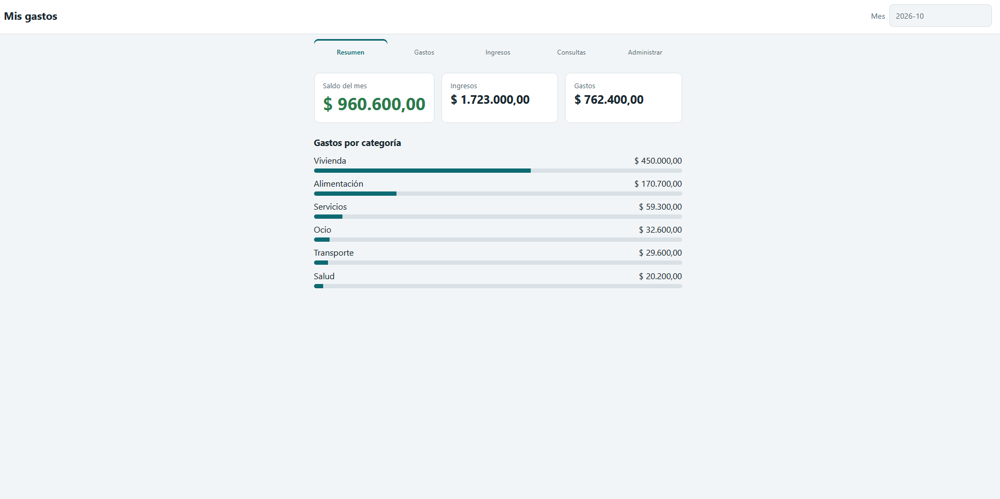
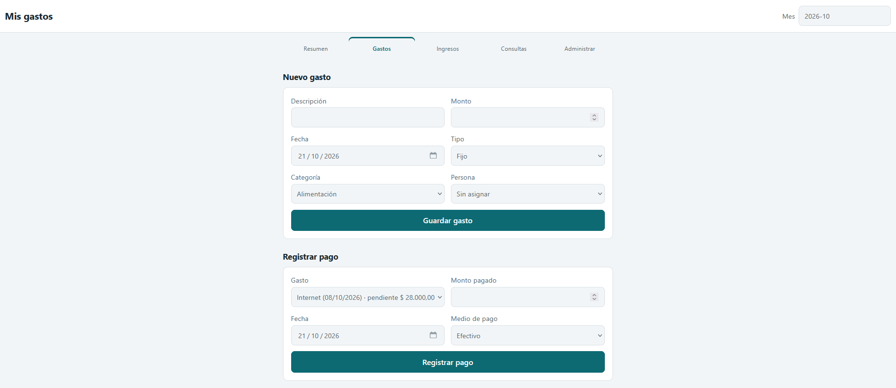
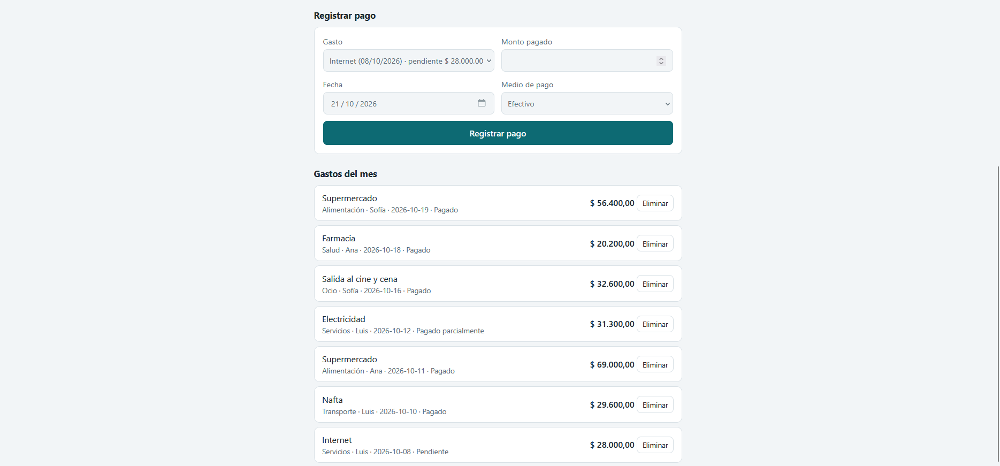
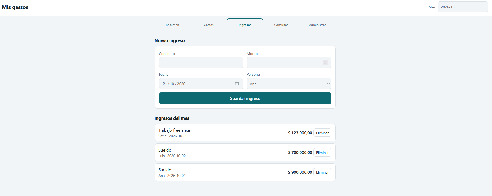
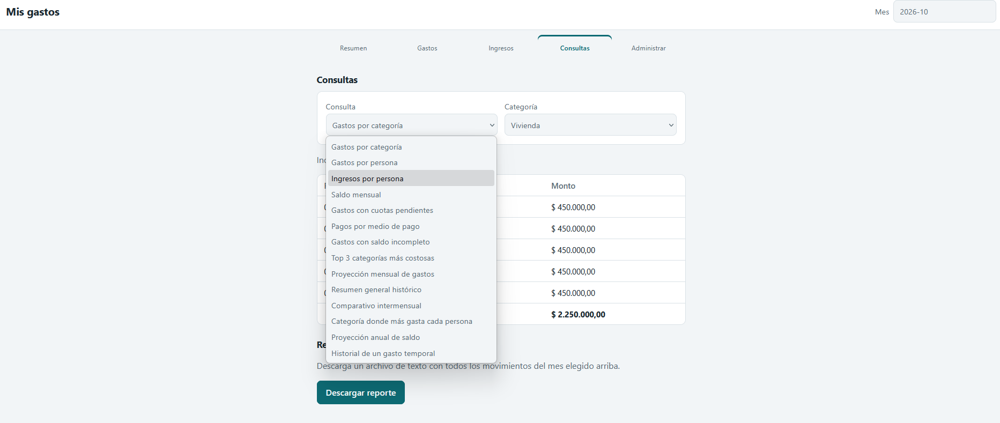
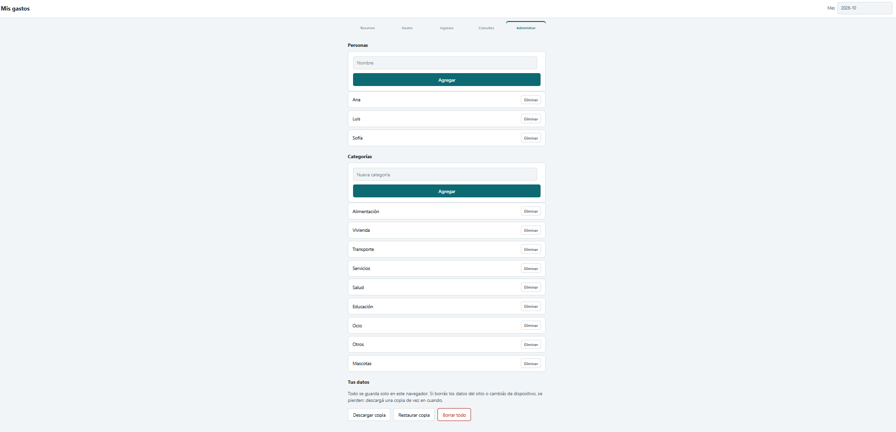

# Sistema de Gestión de Gastos Personales – Versión Web (Mis Gastos)

Este repositorio contiene la **versión web moderna (100% Client-Side)** refactorizada a partir del Trabajo Práctico Integrador (TPI) de la materia **Programación Estructurada (Año 2025)** de la **Universidad Gastón Dachary**, originalmente desarrollado como una aplicación de consola en lenguaje C.

El proyecto permite la gestión integral de finanzas personales o familiares (control detallado de ingresos, gastos, pagos, categorías y proyecciones) directamente desde el navegador de cualquier dispositivo móvil, tablet o computadora, garantizando **privacidad absoluta**.


---

## 🌐 Probar la Aplicación en Vivo (Sin instalar nada)

Puedes utilizar la aplicación directamente desde tu navegador ingresando al siguiente enlace desplegado en **Vercel**:

👉 **[Ejecutar Mis Gastos en la Web (Vercel)](https://LINK_DE_VERCEL_AQUI.vercel.app)** *(Reemplazar con tu link final)*

> 🔒 **Nota de Privacidad:** Todo lo que registres en este enlace se guarda **exclusivamente en el navegador de tu propio dispositivo** (`localStorage`). No existe base de datos en servidores externos, por lo que nadie (ni siquiera la administradora de la página) tiene acceso a tus registros financieros.

---

## 📜 Descripción del Proyecto

El objetivo de este software es permitir a una persona o a un grupo familiar registrar y organizar sus ingresos y gastos mensuales de forma clara e intuitiva. El sistema ayuda a identificar a qué se destina el dinero, quién realiza cada movimiento y cómo evolucionan los saldos mes a mes para tomar mejores decisiones financieras.

En esta evolución desde la versión en C hacia una aplicación web:
- Se reemplazó el almacenamiento en archivos binarios locales (`.dat`) por persistencia en el navegador mediante **`localStorage`** en formato JSON.
- Se mantuvo la generación de **reportes mensuales en archivos de texto (`.txt`)** descargables al instante y se añadió un sistema de **copias de seguridad (`.json`)** para exportar y restaurar los datos entre distintos dispositivos.

### ✨ Funcionalidades Principales

La aplicación se organiza en torno a una barra de navegación principal adaptativa con cinco secciones:

1. **Resumen (Dashboard Mensual):**
   * Visualización rápida del **Saldo del mes**, **Ingresos totales** y **Gastos totales** del período seleccionado en la parte superior.
   * Gráfico de barras proporcional con el desglose de **Gastos por categoría** del mes.

2. **Gastos y Pagos:**
   * **Nuevo Gasto:** Permite registrar gastos asociándolos a una categoría, fecha y persona, clasificados en cuatro tipos:
     * **Fijo** (ej. alquiler, internet).
     * **Ocasional** (ej. salidas, compras puntuales).
     * **Temporal (en cuotas)** (ej. compras financiadas, indicando el total de cuotas y las cuotas ya pagadas).
     * **Anual** (ej. matrícula, seguros).
   * **Registrar Pago:** Permite abonar total o parcialmente un gasto pendiente indicando la fecha y el medio de pago (*Efectivo, Débito, Crédito, Transferencia u Otro*). El estado del gasto se calcula automáticamente (**Pendiente**, **Pagado parcialmente** o **Pagado**).
   * **Listado de Gastos del Mes:** Muestra el detalle de cada movimiento con su estado actual y opción de eliminación lógica.

3. **Ingresos:**
   * **Nuevo Ingreso:** Asocia un ingreso a una persona registrada, indicando concepto, monto y fecha.
   * **Listado de Ingresos del Mes:** Historial ordenado por fecha con opción de baja lógica.

4. **Consultas y Reportes:**
   * Filtrar **gastos por Categoría** (histórico con sumatoria total).
   * Filtrar **gastos por Persona** (del mes seleccionado, incluyendo gastos sin asignar).
   * Mostrar **ingresos por Persona** (histórico con total acumulado).
   * Calcular el **Saldo Mensual** (Ingresos vs. Gastos).
   * Mostrar **gastos con cuotas Pendientes** (compras temporales con detalle de cuotas pagadas, restantes y saldo).
   * Filtrar **pagos por Medio de Pago** (efectivo, débito, crédito, transferencia, otro).
   * Listar **gastos con Saldo Incompleto** (pendientes o pagados parcialmente).
   * Ver el **Top 3 categorías más costosas** del mes seleccionado.
   * Calcular la **Proyección Mensual de gastos** (basada en el promedio de los últimos 3 meses).
   * Mostrar el **Resumen General histórico** (meses con movimientos, totales acumulados y promedios mensuales).
   * **Comparativo intermensual** de gastos (totales por mes y porcentaje de variación respecto al mes anterior).
   * **Categoría donde más gasta cada persona** (distribución porcentual por miembro y rubro principal).
   * **Proyección anual de saldo** (estimación acumulada para los próximos 12 meses).
   * **Historial de un gasto temporal** (cronograma de cuotas y tabla de pagos registrados para ese gasto).
   * **Reporte Mensual Descargable:** Botón para generar y descargar un archivo de texto legible (ej. `resumen_octubre_2026.txt`) con todos los ingresos, gastos, pagos y balances del mes.

5. **Administrar:**
   * **Gestión de Personas:** Alta y baja lógica (*soft delete*) de los miembros de la familia o usuarios.
   * **Gestión de Categorías:** Alta y baja lógica de categorías personalizadas (incluye categorías iniciales listas para usar).
   * **Gestión de Datos Locales (Backup):** Permite **Descargar copia** (`.json`), **Restaurar copia** desde un archivo y **Borrar todo** para reiniciar la aplicación.

---

## 🛠️ Aspectos Técnicos y Migración (De C a Web)

- **Tecnologías:** HTML5 Semántico, CSS3 Moderno (Variables CSS, Flexbox, CSS Grid, diseño *Mobile-First* y Modo Oscuro automático con `prefers-color-scheme`) y JavaScript Vanilla (ES6+).
- **Cero Dependencias Externas:** La aplicación no utiliza frameworks pesados ni realiza peticiones de red externas, garantizando carga instantánea y privacidad total.
- **Arquitectura Modular en JavaScript vs. C:**

| Módulo en `script.js` | Responsabilidad en la Web | Equivalente en la versión original en C |
| :--- | :--- | :--- |
| **`Store`** | Lectura, escritura, exportación JSON e importación en `localStorage`. | Manejo de archivos binarios (`gastos.dat`, `ingresos.dat`, `pagos.dat`, `personas.dat`, `categorias.dat`) con `fread` y `fwrite`. |
| **`Calc`** | Funciones puras de lógica de negocio, sumatorias, saldos, estados de pago y proyecciones. | Funciones de cálculo y filtrado en `funciones.h` y estructuras de `estructuras.h`. |
| **`Acciones`** | Altas de registros, imputación de pagos y bajas lógicas (`activo: false`). | Funciones de registro y *soft delete* (`status = 0`). |
| **`UI` y `CONSULTAS`** | Renderizado dinámico del DOM, tablas de consultas y eventos de formularios. | Menús interactivos de consola, `printf` y gráficos con `windows.h` (`gotoxy`, `setColor`). |

---

## 🚀 Cómo Ejecutar o Descargar el Proyecto

Tienes dos formas de utilizar este sistema: directamente desde internet o descargando el código en tu computadora.

### Opción 1: Usar la versión Online (Recomendado)
1. Ingresa desde tu celular, tablet o PC a **[https://LINK_DE_VERCEL_AQUI.vercel.app](https://LINK_DE_VERCEL_AQUI.vercel.app)**.
2. ¡Listo! Ya puedes empezar a cargar personas, categorías, ingresos y gastos.
3. *Consejo:* Usa el botón **"Descargar copia"** en la pestaña *Administrar* de vez en cuando para guardar un respaldo de tus datos o pasarlos de tu PC a tu celular.

### Opción 2: Descargar el Código y Ejecutarlo Localmente
Si deseas revisar el código fuente, modificarlo o usarlo sin conexión a internet en tu computadora:

1. **Descargar los archivos:**
   * Haz clic en el botón verde **`<> Code`** arriba a la derecha en este repositorio de GitHub y selecciona **"Download ZIP"**, luego descomprime la carpeta en tu computadora.
   * *(Opcional con Git)* Clona el repositorio ejecutando en tu terminal:
     ```bash
     git clone [https://github.com/TU_USUARIO/TU_REPOSITORIO.git](https://github.com/TU_USUARIO/TU_REPOSITORIO.git)
     ```
2. **Estructura de archivos que encontrarás:**
   ```text
   ├── index.html   # Estructura semántica de las 5 vistas y formularios
   ├── styles.css   # Estilos responsivos (Mobile-First) y tema claro/oscuro
   └── script.js    # Motor de persistencia local, cálculos y consultas
   ```

3. **Ejecutar la aplicación:**
   - **Apertura directa:** Haz doble clic en `index.html` para abrirla en tu navegador predeterminado (Chrome, Edge, Firefox o Safari).
   - **Con un servidor local:** Abre la carpeta en Visual Studio Code y usa la extensión *Live Server*, o ejecuta en una terminal desde esa carpeta:

     ```bash
     python -m http.server 8000
     ```

     Luego abre [http://localhost:8000](http://localhost:8000) en tu navegador.

## 📋 Archivos Generados por la Aplicación

Al igual que la versión original en C, la versión web permite trabajar con datos locales y archivos descargables para reportes y respaldos:

- **`localStorage` (`gastos-app:v1`):** Base de datos interna del navegador que reemplaza a los antiguos archivos `.dat`.
- **`resumen_[mes]_[año].txt`:** Reporte generado desde **Consultas → Descargar reporte**, con el detalle de ingresos, gastos, pagos y saldo del mes elegido. Por ejemplo: `resumen_octubre_2026.txt`.
- **`gastos-copia-[fecha].json`:** Copia de seguridad generada desde **Administrar → Descargar copia**, con personas, categorías, gastos, ingresos y pagos para restaurar los datos en otro momento o dispositivo.

## 📸 Capturas de Pantalla

### 1. Apartado de Resumen Mensual



### 2. Gestión de Gastos y Registro de Pagos





### 3. Registro y Listado de Ingresos



### 4. Módulo de Consultas Dinámicas y Reportes



### 5. Administración de Personas, Categorías y Copias de Seguridad



## 👨‍💻 Autores y Créditos

- **Adaptación y desarrollo web Full Stack (Client-Side):** Martinez, Mariana Priscila.
- **Equipo original del TPI en C (Programación Estructurada 2025 - UGD):**
   - Godoy, Tomas
   - Martinez, Mariana Priscila
   - Moreno, Francisco
   - Scheuermann, Renata

## 📄 Licencia

Este proyecto se distribuye bajo la Licencia MIT.
